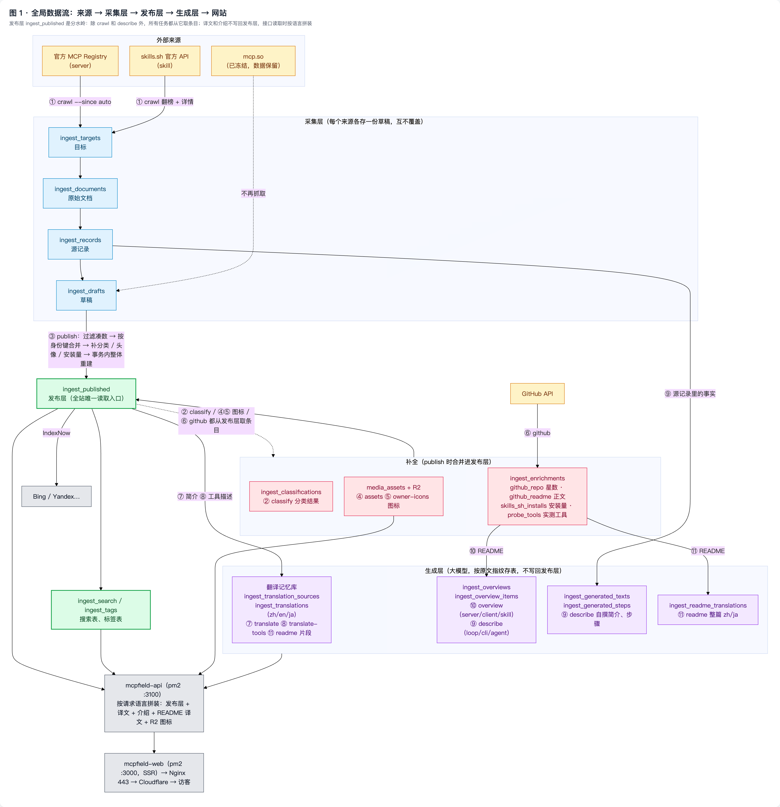
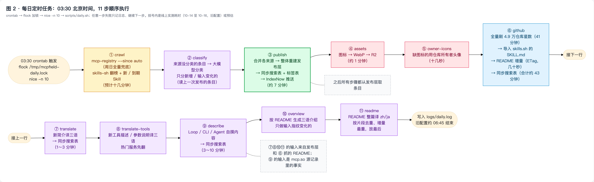
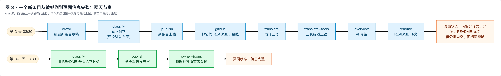
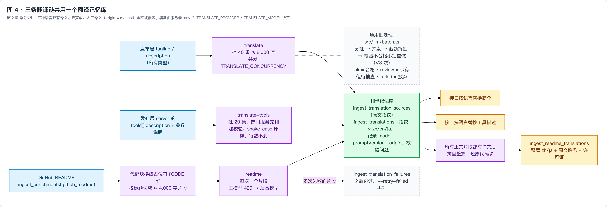
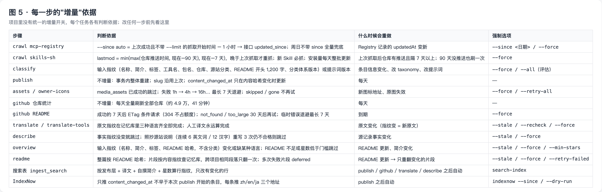
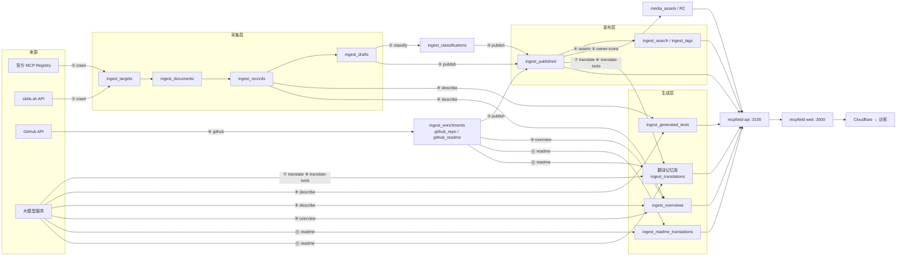

# MCP Field 后台运行流程与每日定时任务

> 整理于 2026-10-16，依据 `scripts/daily.sh`、`src/cli/index.ts`、各任务模块的实现，以及线上服务器 `43.165.173.197` 的 crontab 与日志。
> 设计原理见 [DESIGN.md](DESIGN.md)，计划与进展见 [PLAN.md](PLAN.md)。本文只回答一个问题：**后台每天到底跑了什么、按什么顺序、每一步怎么判断"增量"。**

## 0. 流程图

五张图在 `docs/images/`，源文件是 [pipeline-diagrams.html](pipeline-diagrams.html)（浏览器打开即可看，Mermaid 画的；改完后按文末的方法重新截图）。











## 1. 一张图看全流程（文字版）

```
                     ┌──────────────────── 每日 03:30（北京时间）crontab → scripts/daily.sh ────────────────────┐
                     │                                                                                            │
  外部来源           │  ① crawl              ② classify          ③ publish                 ④ assets ⑤ owner-icons │
  ───────────        │  ─────────            ──────────          ─────────                 ───────────────────── │
  官方 MCP Registry ─┼─► ingest_targets ──► ingest_classifications ─┐                        media_assets（R2）    │
  skills.sh ─────────┼─► ingest_documents                            ├─► ingest_published ◄───┘  （图标转存、头像补全）│
  (mcp.so 已冻结)    │   ingest_records                               │    ingest_published_slugs                     │
                     │   ingest_drafts ───────────────────────────────┘    ingest_search / ingest_tags               │
                     │   ingest_enrichments(skills_sh_installs)            IndexNow 推送                             │
                     │                                                                                            │
  GitHub API ────────┼─► ⑥ github ──► ingest_enrichments（github_repo 星数 / github_readme 正文）                  │
                     │                                                                                            │
  大模型 ────────────┼─► ⑦ translate ───────► ingest_translation_sources + ingest_translations（翻译记忆库）        │
  (gpt-6-luna 等)    │   ⑧ translate-tools ──► 同上（工具描述、参数说明）                                           │
                     │   ⑨ describe ────────► ingest_generated_texts / ingest_generated_steps / ingest_overviews   │
                     │   ⑩ overview ────────► ingest_overviews / ingest_overview_items                            │
                     │   ⑪ readme ──────────► 翻译记忆库（片段）+ ingest_readme_translations（整篇）               │
                     └────────────────────────────────────────────────────────────────────────────────────────────┘
                                                             │
                                                             ▼
                     mcpfield-api（pm2，:3100）按请求语言拼装：发布层 + 译文 + AI 介绍 + README 译文 + R2 图标地址
                                                             │
                                                             ▼
                     mcpfield-web（pm2，:3000，SSR）→ Nginx 443 → Cloudflare → 访客
```

同一张图的 Mermaid 版（GitHub 上可直接渲染）：



读法：

- **采集层**只认"来源"，每个来源各存一份草稿，互不覆盖。
- **发布层** `ingest_published` 是全站唯一的读取入口：publish 把多来源草稿合并成一条，整体重建。网站、搜索表、以及后面所有生成任务都以它为准。
- **生成层**（翻译、介绍、README 译文）不写回发布层，各自按"原文指纹"存表，接口读取时按语言拼装。所以 publish 重建不会丢译文，译文更新也不需要重新 publish。

## 2. 每日定时任务

### 2.1 触发方式

线上 crontab（服务器时区 Asia/Beijing）：

```cron
30 3 * * * cd /storage02/mcpfield/app/mcp-field-crawler && mkdir -p logs \
  && PATH=/usr/local/bin:/usr/bin:/bin \
     STEPS="crawl classify publish assets owner-icons github translate translate-tools describe overview readme" \
     nice -n 10 flock -n /tmp/mcpfield-daily.lock ./scripts/daily.sh >> logs/daily.log 2>&1
```

| 要点 | 说明 |
| --- | --- |
| 时间 | 每天 03:30 北京时间。数据库 `ingest_runs.started_at` 存的是 UTC，所以库里看到的是前一天 19:30 |
| 互斥 | `flock -n /tmp/mcpfield-daily.lock`：上一天还没跑完，或有人正用 `mcpfield data` 手动跑，这次直接不启动 |
| 优先级 | `nice -n 10`，让同机的 sub2api 和网站优先 |
| 步骤 | `STEPS` 在 crontab 里**写死**，与 `daily.sh` 的默认值相同；改步骤要两处一起改（见 `deploy/README.md`） |
| 来源 | `CRAWL_SOURCES` 未设置，取 `daily.sh` 默认的 `mcp-registry skills-sh`；mcp.so 自 2026-10-16 冻结 |
| 日志 | `logs/daily.log`，每步前后一行 `[时间] 开始/失败/完成 …`，中间是 pino 的 JSON 行。`mcpfield logs data -f` 看实时，`scripts/progress.sh` 看各任务进度 |
| 容错 | 任意一步失败只记 `失败`，继续跑下一步，脚本最终退出码为 1 |

`daily.sh` 的本体很短：按 `STEPS` 顺序逐个 `npm run crawler -- <步骤>`；只有 `crawl` 特殊，对每个来源各跑一次，且 `mcp-registry` 在非周日加 `--since auto`。

### 2.2 十一步各做什么

| # | 步骤 | 命令 | 做什么 | 读 | 写 | 结束时顺带 |
| --- | --- | --- | --- | --- | --- | --- |
| ① | crawl | `crawl --source mcp-registry --since auto`（周日不带 since）<br/>`crawl --source skills-sh` | 发现目标 → 抓取 → 解析 → 映射成草稿 | 外部 API；skills.sh 另读 ingest_enrichments(github_repo) 的推送时间决定重抓 | ingest_targets / documents / records / drafts / issues / runs；skills.sh 另写 ingest_enrichments(skills_sh_installs) | — |
| ② | classify | `classify` | 来源没给可用分类的条目，用大模型选主分类 + 次分类 | ingest_published（上一次发布的）+ GitHub README 开头 | ingest_classifications | — |
| ③ | publish | `publish` | 过滤凑数条目 → 按身份键合并 → 补分类、所有者头像、仓库简介、实测工具列表、Skill 安装量 → 事务内整体重建 | ingest_drafts、ingest_classifications、ingest_enrichments、media_assets | ingest_published、ingest_published_slugs | 同步搜索表 + 标签表；IndexNow 推送本次内容变化的页面 |
| ④ | assets | `assets` | 发布层里的图标下载 → WebP → 按内容哈希上传 R2 | ingest_published | media_assets、R2 | — |
| ⑤ | owner-icons | `owner-icons` | 没图标或原图失效的条目，用 GitHub 仓库所有者头像补上 | ingest_published、media_assets | media_assets、R2、ingest_published（直接写进草稿图标） | — |
| ⑥ | github | `github` | 先全量刷仓库统计（星数、Fork、归档、最近提交 / 推送、仓库简介），再导入 skills.sh 的 SKILL.md 作为 README，再增量抓 GitHub README | ingest_published、ingest_records(skills-sh) | ingest_enrichments(github_repo / github_readme) | 同步搜索表（星数变了热门顺序要变） |
| ⑦ | translate | `translate` | 简介 tagline / description 译成中英日 | ingest_published | ingest_translation_sources、ingest_translations | 同步搜索表（译文要能搜到） |
| ⑧ | translate-tools | `translate-tools` | MCP 服务的工具描述、参数说明译成中英日，热门服务先翻 | ingest_published（server 的 tools） | 同上翻译记忆库 | — |
| ⑨ | describe | `describe` | Loop / CLI / Agent 没有 README，按源记录里的事实自撰三语简介、概述、功能、场景、步骤 | ingest_records(mcpso) | ingest_generated_texts、ingest_generated_steps、ingest_overviews | 同步搜索表 |
| ⑩ | overview | `overview` | server / client / skill 根据 GitHub README 生成三语介绍（概述、功能、场景、MCP 相关） | ingest_published + ingest_enrichments(github_readme) | ingest_overviews、ingest_overview_items | — |
| ⑪ | readme | `readme` | README 整篇译成中文、日文：代码块占位 → 按章节切片 → 片段去重翻译 → 拼回 | ingest_enrichments(github_readme) | 翻译记忆库（片段）、ingest_readme_translations（整篇）、ingest_translation_failures | — |

顺序的理由：

1. **publish 是分水岭**：除 crawl 和 describe 外，所有步骤都从发布层 `ingest_published` 取条目（classify、github、translate、translate-tools、overview、readme、assets、owner-icons 都是）。发布层不重建，它们看不到新条目。
2. **classify 在 publish 之前，但读的是上一次发布的条目**：所以一个新条目的实际节奏是两天——D 日 crawl 抓到 → D 日 publish 先无分类上线（分类显示为空）→ D 日 github 抓到它的 README → D+1 日 classify 用 README 开头给它分类 → D+1 日 publish 把分类写进发布层。
3. **github 在翻译生成之前**：overview 和 readme 的输入是 GitHub README；星数决定各任务"热门优先"的顺序和 `--min-stars` 门槛；skills.sh 第二天要不要重抓某个 Skill，也看 github 这一步存下的仓库推送时间。
4. **readme 放最后**：最重、最耗模型额度，失败或超时不影响前面任何一步。

一个新条目从被抓到到页面信息完整，时间线大致是：

```
D 日 03:30   crawl 抓到 ──► publish 上线（无分类、无译文）──► github 抓 README、星数 ──► translate 译简介
             ──► translate-tools 译工具描述 ──► overview 生成三语介绍 ──► readme 翻 README
D+1 日 03:30 classify 分类 ──► publish 分类生效 ──► 图标若缺失由 owner-icons 补头像
```

### 2.3 一天的时间线（线上实测）

最近三天（2026-10-14 至 10-16）跑的还是旧配置（抓 mcp.so，7 步）。各步实际耗时：

| 步骤 | 10-14 | 10-15 | 10-16 | 说明 |
| --- | --- | --- | --- | --- |
| crawl mcpso | 2h26m | 2h16m | 2h19m | 已冻结，10-17 起不再跑 |
| publish | 1m（失败） | 7m | 7m | 10-14 因 slug 大小写冲突失败，已修 |
| assets | 1m | 1.5m | 40s | |
| owner-icons | — | 20s | 10s | 10-15 起加入 |
| github | 41m | 44m | 43m | 其中仓库统计 48,688 个仓库约 41 分钟（GraphQL 每批 50、并发 2），README 增量只需几十秒 |
| translate | 1m | 3.5m | 1.5m | 每天只有几十段新简介 |
| describe | 7m | 10m | 2.5m | |
| **合计** | 3h17m | 3h23m | 3h14m | 03:30 开始，约 06:45 结束 |

2026-10-17 03:30 是**第一次按新配置**（Registry + skills.sh 增量，11 步）运行，预期变化：

- crawl 从 2 小时多缩到十几分钟：Registry 增量只拉上次成功全量（2026-10-12）之后更新的；skills.sh 翻榜约 6 分钟（4 页并发）+ 新 Skill 和到期 Skill 的详情。
- classify / translate-tools / overview 首次进入每日任务，但全量已经用 `mcpfield run` 手工跑过（见 §5），每天只处理新增，预计各几分钟。
- readme 全量还没跑完（§5），每日任务里它会接着跑剩下的，首几天这一步会很长（单轮约 3 小时）；它在最后一步，不拖累别的。

## 3. 每一步的增量规则

"增量"在这个项目里没有统一开关，每个任务各有自己的判断依据。改任何一步前先看这张表。

| 步骤 | 判断依据 | 什么情况会重做 | 强制选项 |
| --- | --- | --- | --- |
| crawl（通用） | 目标的 `lastmod` 与上次抓取时间比：不晚于上次 `fetchedAt` 就跳过；抓取用 ETag / Last-Modified 条件请求，内容哈希没变不重新解析 | 来源给的 lastmod 变新；文档内容变化 | `--force` 忽略全部判断 |
| crawl mcp-registry | `--since auto` = 上次**成功且不带 --limit** 的 crawl 开始时间往前 1 小时，传给接口 `updated_since`；周日不带 since 全量兜底 | Registry 记录的 `updatedAt` 变新 | `--since <日期>`、`--force` |
| crawl skills-sh | 排行榜没有更新时间，用 github 步骤存的仓库 `pushedAt` 算 lastmod：`min(max(推送时间, 现在-90天), 现在-7天)`。效果：新 Skill 必抓；已收录的要"上次抓取后有推送且隔 7 天以上"；90 天没推送的也每 90 天刷一次；查不到推送时间的每 7 天一次 | 同上 | `--force` |
| skills.sh 安装量 | 不走增量：发现时每天把全站榜的累计安装量整批写进 ingest_enrichments，publish 时取较大值更新到 Skill | 每天都更新 | — |
| classify | 输入指纹（名称、简介、标签、工具名、包名、仓库、源站分类原值、README 开头 1,200 字、分类体系版本）或提示词版本变了 | 条目信息变化、改了 taxonomy、改了提示词 | `--force`；`--all` 连来源有分类的也分（评估用） |
| publish | 不增量，每次整体重建（事务内先删后写，网站读到的要么全旧要么全新）。地址 slug 沿用上次发布的；`content_changed_at` 只在内容哈希变化时更新 | 每天 | — |
| assets | `media_assets` 里已成功的跳过；失败按 1h → 4h → 16h …… 最长 7 天退避重试；格式不支持记 skipped、原图 404 记 gone 不再重试 | 新图标地址 | `--force` 重处理已成功的；`--retry-all` 连 skipped / gone 也重试 |
| owner-icons | 发布层里没图标或图标记录为 gone / skipped 的条目；同一所有者只转存一次 | 新条目、原图失效 | 同 assets |
| github 仓库统计 | **不增量**，每次全量更新所有仓库（约 4.9 万个，41 分钟），某批失败只跳过这批 | 每天 | — |
| github README | 成功的 7 天后用 ETag 条件请求检查（304 不占额度）；not_found / too_large 的 30 天后再试；临时错误 1h → 4h → …… 7 天退避；已抓到的刷新失败保留原文 | 到期 | `--force` 忽略到期时间和 ETag |
| skills.sh SKILL.md 导入 | 内容哈希相同且在有效期内不重写；每次 github 运行都顺延有效期，GitHub 就不会再请求这些 Skill | SKILL.md 内容变化 | — |
| translate | 原文按指纹存 `ingest_translation_sources`；三种语言都有译文（`ingest_translations` 三行）即视为完成。人工译文（origin = manual）永远算完成、永不覆盖 | 原文变化（指纹变 → 新原文） | `--stale` 旧提示词版本的重翻；`--recheck` 按当前校验规则重查已有译文、只重翻不合格的；`--force` 全部重翻（人工的除外） |
| translate-tools | 与 translate 共用记忆库和规则，另加两条软校验（snake_case 标识符原样保留、行数不变）；按服务热度排序，`--limit` 和中途停止时也是热门的先有译文 | 同 translate | 同 translate；`--min-stars` 只翻热门 |
| describe | 事实指纹（命令、安装方式、示例、链接、步骤等）没变就跳过；与源站说明连续 6 个英文词 / 12 个汉字相同判为照抄，重写 3 次仍不合格则跳过，页面显示"暂无简介" | 源记录事实变化 | `--stale`、`--force` |
| overview | 输入指纹（名称、简介、标签、README 哈希，**不含分类**）或缺某种语言就重做；README 不足或星数低于 `--min-stars` 的跳过。收集时边读边过滤，内存里只留要生成的 | README 更新、简介变化 | `--stale`、`--force` |
| readme | 整篇按 README 哈希判断要不要重译；片段按内容指纹查记忆库，不同项目里相同段落只翻一次；内容上多次失败的片段记进 `ingest_translation_failures`，之后的运行**跳过**（deferred） | README 更新 → 只重翻变化的片段 | `--stale`、`--force`；`--retry-failed` 把 deferred 的片段补上（全量跑完后用） |
| 搜索表 ingest_search | 按发布层 + 简介译文 + 自撰简介 + 星数算每条的搜索行指纹，只改有变化的行；同一时间只允许一个同步 | publish / github / translate / describe 之后自动 | `search-index` 手动全量 |
| IndexNow | 只推 `content_changed_at` 不早于本次 publish 开始时间的条目，每条推中英日三个地址；源站批量刷新更新时间不算内容变化 | publish 之后自动（配了 `INDEXNOW_KEY`） | `indexnow --since <时间>` 补推，`--dry-run` 只看地址 |

关于 `--since auto` 的一个细节：`lastSucceededRun` 只认 `status = succeeded` 且 options 里没有 `limitPerKind` 的运行。所以 2026-10-16 白天的两次 `--limit 10` 试跑不会被当成基准，10-17 的增量会以 10-12 的全量为起点，把这几天的更新一次性补齐。

## 4. 三条翻译链

翻译相关有三条链，共用一个翻译记忆库和一套模型配置，但输入和粒度不同。

```
                                  ┌─────────────── 翻译记忆库 ───────────────┐
简介（tagline/description）────► translate ──────► ingest_translation_sources（原文，按指纹去重）
工具描述 / 参数说明 ───────────► translate-tools ─► ingest_translations（每个指纹 × zh/en/ja 各一行，
README 片段 ───────────────────► readme ─────────►   记录 model、promptVersion、origin、校验问题）
                                  └──────────────────────────────────────────┘
                                                        │
README 整篇 ◄── readme 拼回代码块 ──► ingest_readme_translations（zh/ja 整篇、翻译时的 README 哈希、许可证）
AI 介绍 ◄───── overview / describe ─► ingest_overviews + ingest_overview_items（不经过记忆库，直接三语生成）
```

| 链 | 原文来源 | 粒度 | 批次 | 并发 | 校验要点 |
| --- | --- | --- | --- | --- | --- |
| translate | 发布层 tagline / description | 一段简介 | 40 条，合计 ≤ 8,000 字 | `TRANSLATE_CONCURRENCY`，默认 4 | 中文不能有假名、日文不混简体、不照抄原文 |
| translate-tools | 发布层 server 的 tools[].description、参数说明 | 一条描述 | 20 条，≤ 8,000 字 | 同上 | 另加：snake_case 标识符原样、行数不变（软性，标记 review） |
| readme | GitHub README（ingest_enrichments） | 按标题切的片段，≤ 4,000 字 | 每次一个片段 | `TRANSLATE_CONCURRENCY`，默认 6 | 占位符数、链接图片数一个不少；必须真译成目标语言；行内代码、标题数、表格行数、长度比例不一致标 review |

模型与服务由服务器 `.env` 决定（本机不跑写库任务）：

| 任务 | 环境变量 | 当前线上 |
| --- | --- | --- |
| translate / translate-tools / readme | `TRANSLATE_PROVIDER` + `TRANSLATE_MODEL` / `README_MODEL` | provider = openai（OpenAI 兼容网关），模型 gpt-6-luna |
| readme 限流后备 | `README_FALLBACK_PROVIDER` / `README_FALLBACK_MODEL` | 主模型 429 时切后备，暂停 1 → 2 → …… 15 分钟后再试主模型 |
| overview | `OVERVIEW_PROVIDER` / `OVERVIEW_MODEL`（可选 `OVERVIEW_PREMIUM_MODEL` 按星数分档） | 见 .env |
| describe | `DESCRIBE_PROVIDER` / `DESCRIBE_LOOP_MODEL`（Loop 用强模型）/ `DESCRIBE_MODEL` | Agent 用 gpt-6.1-sol（10-16 日志） |
| classify | `CLASSIFY_PROVIDER` / `CLASSIFY_MODEL` | 默认 claude-opus-5-5 |

所有大模型任务都走 `src/llm/batch.ts` 的同一套批处理：分批 → 并发 → 输出被截断时拆批 → 校验不合格的小批次重做（最多 3 次）→ 统计 token 用量。日志里的 `ok / review / failed` 分别是合格、保存但标记待抽查、多次重做仍不合格。

## 5. 当前线上状态（2026-10-16 12:40 北京时间）

发布层各类型条目数：

| kind | 条目 |
| --- | --- |
| server | 53,666 |
| skill | 92,698 |
| client | 389 |
| cli | 170 |
| agent | 63 |
| loop | 40 |

补全与生成任务的进度（来自 `ingest_enrichments` 和各 `run-*.log` 的最后一行）：

| 任务 | 状态 |
| --- | --- |
| github_repo | 43,457 个仓库有统计，5,254 个仓库不存在 |
| github_readme | 121,272 篇成功，6,538 不存在，3 篇过大 |
| classify | 10-13 全量完成，11,727 条新分类；每日只分新条目 |
| translate | 131,786 段简介已全部翻完，每天新增几十段 |
| translate-tools | 10-16 这一轮（`mcpfield run`）处理 124,787 段：ok 122,415 / review 2,292 / failed 80，用时 83 分钟 |
| overview | 10-16 这一轮处理 15,084 条：ok 14,835 / review 221 / failed 28，用时 91 分钟 |
| readme | 10-16 02:59 跑完一轮（11,029 秒）：目标 122,444 篇，本轮处理 18,572 篇，整篇拼出 17,874；还有 incomplete 6,445、deferred 7,248 个片段。每日任务会继续推进；全部跑完后需手动 `readme --retry-failed` 补 deferred 的片段 |
| probe_tools | 54 个本地服务实测出工具列表（实测机 43.165.134.157 上跑 probe-local，结果经 probe-import 导入；代码尚未提交） |
| describe | 有 3 个 agent（thread-otter、grok-bot-credit-card-max、poke-ai-assistant）每天重写 3 次仍判为照抄，稳定失败，可忽略或换模型单独跑 |

## 6. 不在每日任务里的命令

| 命令 | 用途 | 何时跑 |
| --- | --- | --- |
| `crawl --source <id> --limit 10` | 新来源 / 改了解析后本地小样本验证 | 上线前（见记忆：先本地 --limit 10，再 deploy + run 全量） |
| `remap --source <id>` | 改了映射规则后不发网络请求重建草稿 | 改 mapper 后，之后要 publish |
| `merge-plan` | 合并预演，只读，报告写 `data/merge-plan` | 改身份键规则后 |
| `search-index` | 手动全量同步搜索表和标签表 | 一般不需要，publish 会自动做 |
| `indexnow --since <时间>` | 补推 IndexNow | publish 日志里出现"IndexNow 推送失败"时 |
| `translate --recheck` / `--stale` | 改了校验规则 / 提示词后重查重翻 | 改规则后手动一次 |
| `readme --retry-failed` | 补翻多次失败过的片段 | 全量跑完后 |
| `classify --all` | 连来源有分类的也分，与源站对比评估 | 评估用，发布仍以来源为准 |
| `probe-targets` → `probe-local` → `probe-import` | 本地 MCP 服务实测工具列表：线上列目标 → 实测机 Docker 沙箱跑 → 结果导回线上，publish 后生效 | 手工，分三台机器 |
| `stats` | 采集层统计（目标状态、记录数、补全结果、质量问题、最近运行） | 排查时 |

## 7. 运维入口（本机执行）

| 想做什么 | 命令 |
| --- | --- |
| 看今天跑到哪了 | `mcpfield logs data -f`，或 `mcpfield ssh` 后 `./scripts/progress.sh` |
| 现在立刻跑一遍全部 | `mcpfield data`（与定时任务共用同一把锁，定时任务跑着时不会重复启动） |
| 只跑其中几步 | `mcpfield data translate overview` |
| 后台跑任意命令并带参数 | `mcpfield run readme --retry-failed`，日志 `mcpfield logs readme -f`；同名命令同时只允许一个 |
| 停掉后台命令 | `mcpfield stop readme`；所有命令都是增量的，重新 run 从断点继续 |
| 看最近一次每日任务结果 | `mcpfield status` 底部会打印 `daily.log` 最后 3 行 |
| 改每日步骤 | 改 `scripts/daily.sh` 默认值 **和** 服务器 crontab 的 `STEPS`，然后 `mcpfield deploy api` |

日志位置（服务器 `/storage02/mcpfield/app/mcp-field-crawler/logs/`）：`daily.log` 是定时任务；`run-<命令>.log` 是 `mcpfield run` 启动的手工任务。pino 的 JSON 行里 `level` 40 是警告、50 是错误，`progress` 字段是进度。

## 8. 管理后台的数据

后台（admin.mcpfield.com，见 `mcp-field-admin/README.md`）只读 `admin_*` 表，不直接查发布层，数据量再大也是走索引的小查询。数据分两部分：

**任务运行记录**（`admin_job_batches` / `admin_job_runs`）：CLI 每跑一个命令（每日任务的步骤和常用手动命令，见 `cli/index.ts` 的 `TRACKED`）记一行：开始时间、每 15 秒的心跳和进度（日志里的 `progress` 字段，README 翻译用按篇的 `stepProgress`）、最后 30 条警告和错误日志、结束时命令返回的统计（汇总出成功 / 待抽查 / 失败条数）、最终状态（成功 / 有警告 / 失败 / 中断）。`daily.sh` 开头用 `job-batch start` 建一个批次，批次号通过环境变量 `MCPFIELD_BATCH_ID` 传给各步骤。进程被 kill -9 时状态停在 running，心跳超过 5 分钟没更新按“中断”显示。

**条目状态**（`admin_item_status`，每个发布条目一行的宽表；`admin_coverage`，各类型 × 各补全项的计数）：不在任务里逐条埋点，而是由 `admin/sync.ts` 从各结果表推导，任务中途失败、手动补跑、改了逻辑，同步一次就对得上。每一步结束时自动只刷新这一步影响的列（`STAGES_AFTER`，publish 之后全部），也可以手动 `admin-sync [--stages a,b]`。全量约 40 秒（第一次要读全部 README 算指纹，约 80 秒）。

| 补全项 | 完成 | 警告 | 失败 | 不适用 |
| --- | --- | --- | --- | --- |
| 分类 | 发布层有分类 | 分类器把握不足 | — | — |
| 图标 | media_assets 已转存 | 草稿里没有图标 | 转存失败、原图 404、格式不支持 | — |
| GitHub | github_repo 有统计 | 仓库不存在或私有 | 请求出错 | 没有 GitHub 仓库 |
| README | github_readme 抓到 | 仓库没有 README、过大 | 请求出错 | 没有仓库 |
| 简介翻译 | 简介、描述的原文指纹三语都有 | 有待抽查的译文 | — | 没有简介 |
| 工具列表 | 草稿里有工具 | 没有安装包或远程地址 / 实测结果没被采用 | 实测失败 | 不是 MCP 服务 |
| 工具翻译 | 全部工具描述三语都有 | 有待抽查 | — | 没有工具描述 |
| AI 介绍 | ingest_overviews 三语都有 | 待抽查 | — | 没有 README 或 README 不足 200 字（Loop / CLI / Agent 由 describe 写，总是适用） |
| README 翻译 | 当前 README 指纹的中、日译文都有（本身是中文 / 日文的那种语言不需要） | 待抽查 | — | 没有 README、纯文本 README |

其余情况都是“待处理”；后台显示时，正在运行的步骤里“待处理”的条目显示为“进行中”。收录时间取同一身份键下所有来源里最早被发现的时间（`ingest_targets.discovered_at`），按北京时间归日。不在发布层的条目保留行、标为下架，历史的每日新收录数不受影响。

## 9. 重新生成流程图

改了 `docs/pipeline-diagrams.html` 后，在 `docs/` 目录下用本机 Chrome 截图（Python Playwright 已装；CDN 慢时把 `mermaid.min.js` 请求重定向到本地的 npm 包）：

```bash
cd /tmp && npm pack mermaid@11 && tar xzf mermaid-*.tgz   # 只需一次，得到 /tmp/package/dist/mermaid.min.js
python3 - <<'EOF'
from playwright.sync_api import sync_playwright
import pathlib
html = pathlib.Path('pipeline-diagrams.html').resolve().as_uri()
with sync_playwright() as p:
    b = p.chromium.launch(channel="chrome")
    pg = b.new_page(viewport={"width": 2400, "height": 1200}, device_scale_factor=2)
    pg.route("**/mermaid.min.js", lambda r: r.fulfill(path='/tmp/package/dist/mermaid.min.js', content_type="application/javascript"))
    pg.goto(html, wait_until="domcontentloaded")
    pg.wait_for_function("document.querySelectorAll('.mermaid svg').length === 6", timeout=60000)
    for i in range(1, 6):
        pg.locator(f'#fig{i}').screenshot(path=f'images/pipeline-{i}.png')
    b.close()
EOF
```
